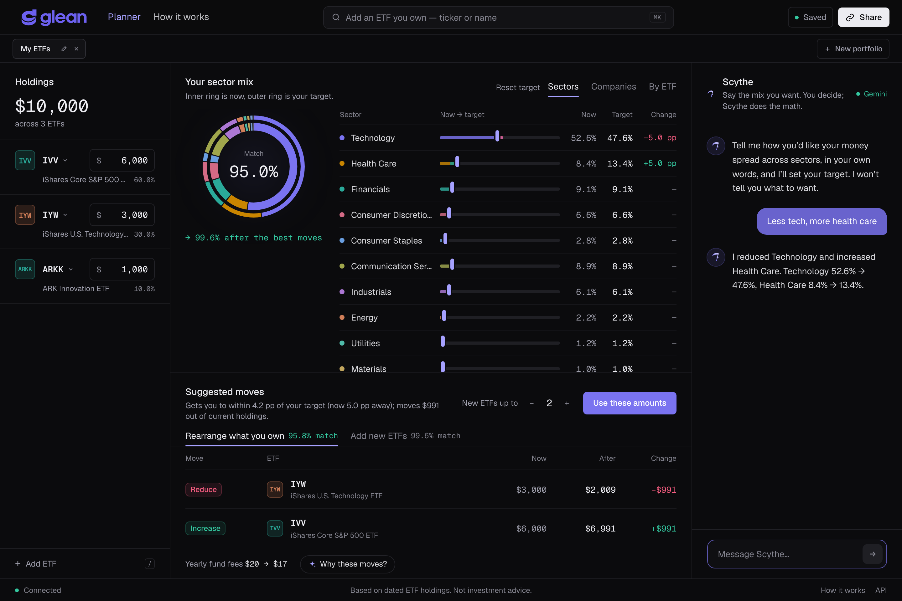
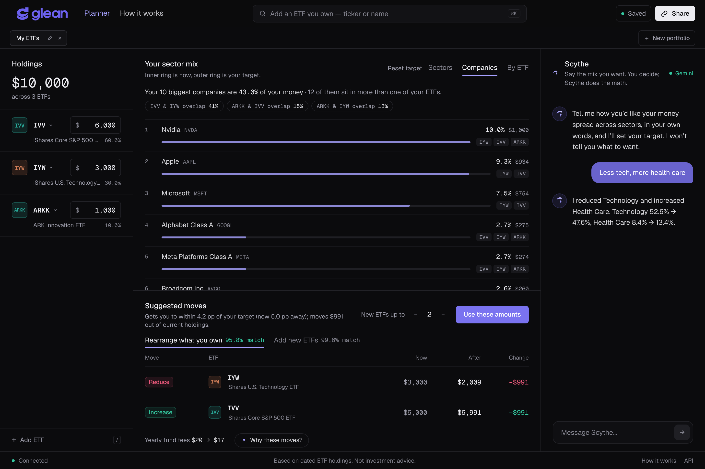
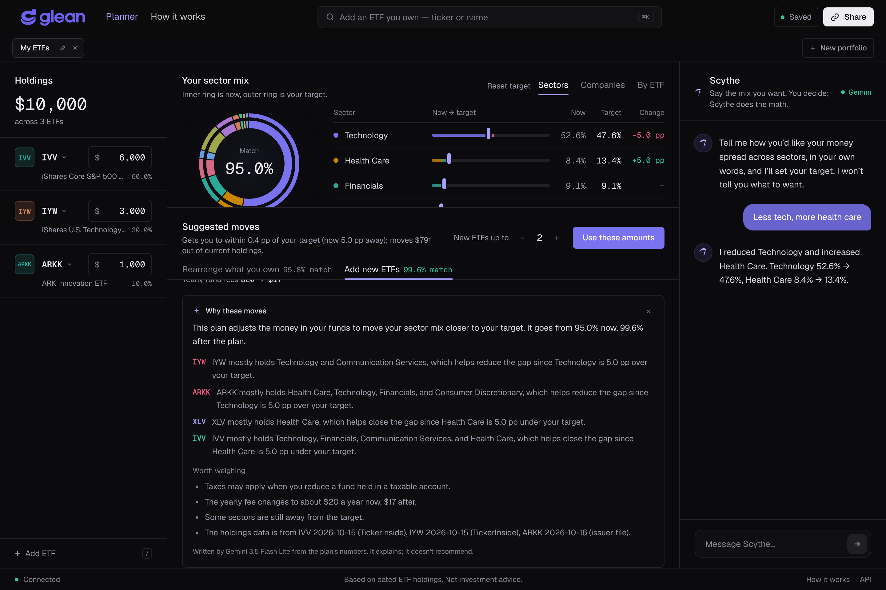
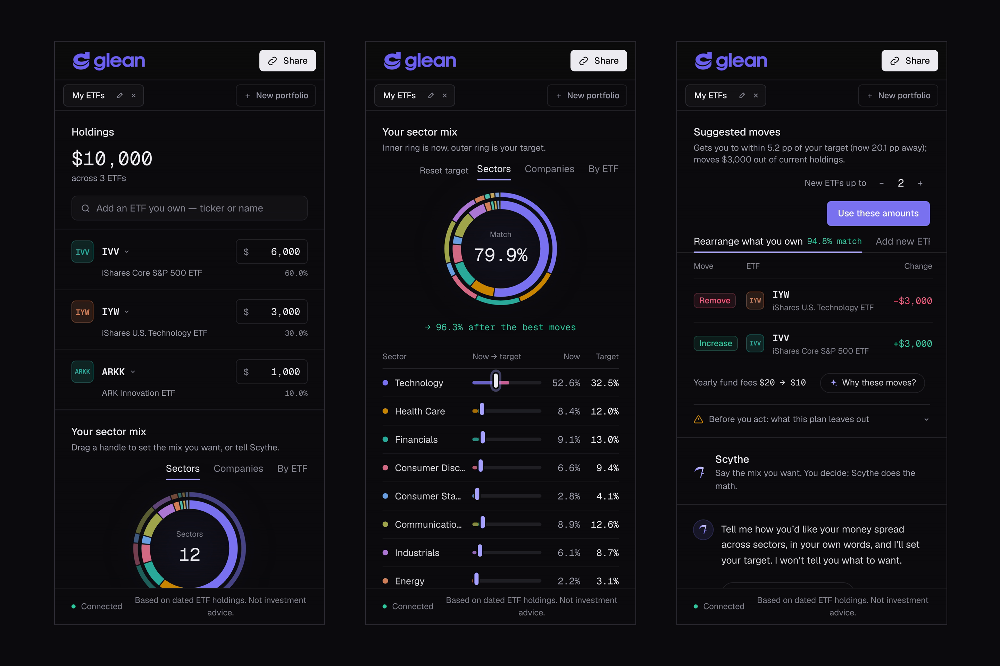
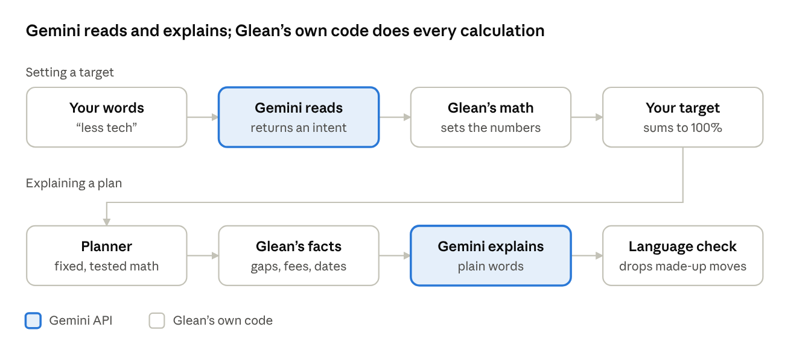

# Glean: see what your ETFs really hold

Technica 2026 submission · Oct 18, 2026

**Live app:** [glean-etf.vercel.app](https://glean-etf.vercel.app) · **Demo video:** [media/glean-demo.mp4](media/glean-demo.mp4) (2:04, 1080p) · Prizes entered: T. Rowe Price NextGen Finance Innovation Challenge, MLH Best Use of Gemini API, Technica Uncharted Waters: Best Beginner Hack.

| | |
| --- | --- |
|  |  |
|  |  |

What's in this folder:

| Path | What it is |
| --- | --- |
| [`media/glean-demo.mp4`](media/glean-demo.mp4) | The demo video, recorded on the live site with captions for each step |
| [`media/00-cover.png`](media/00-cover.png) to [`media/08-phone.png`](media/08-phone.png) | Devpost gallery images (3:2, each under 5 MB) |
| [`media/gallery-captions.txt`](media/gallery-captions.txt) | Suggested gallery order and captions |
| [`demo/`](demo/) | The scripts that record the video and take the screenshots (Playwright) |
| [`checks/`](checks/) | The production check suites and the Gemini evaluation mentioned below |

## Inspiration

New investors often hold three or four ETFs and believe they are diversified, when the funds hold mostly the same companies. A common starter mix, an S&P 500 fund (IVV) plus a tech fund (IYW) plus ARK Innovation (ARKK), puts about 53% of the money in Technology. In our example portfolio the 10 biggest companies are about 45% of it, and IVV and IYW share about 44% of their holdings.

Brokerage apps show each fund's ticker and balance, not what sits inside. Look-through tools exist, but they are built for advisors and assume you already speak finance. We wanted a beginner to see their real exposure in one screen, say in plain words what they want instead, and get the exact dollar moves, without being told what to want.

## What it does

Glean is a one-screen tool: enter the ETFs you hold and the dollars in each, and it shows what you really own and how to reach the mix you want with the money already invested.

1. **Holdings.** Search any U.S.-listed ETF and type your dollar amounts. Each fund shows its sectors, its yearly fee in dollars (linked to the SEC filing it comes from) and a Gemini-written "What's inside?" summary.
2. **Your real sector mix.** Glean opens every fund's holdings (SEC N-PORT filings, issuer files and TickerInside data) and adds them up into one look-through sector mix.
3. **Companies.** The same companies are counted once across all your funds, with the share your top 10 make up and how much each pair of funds overlaps.
4. **Your target.** Drag a slider per sector, or tell Scythe, the Gemini-powered assistant, in your own words: "less tech, more health care", "no energy", "no sector above 20%".
5. **Suggested moves.** Two plans, "Rearrange what you own" and "Add new ETFs" (from a short list of plain, low-cost index funds), with exact Add / Increase / Reduce / Remove amounts, the match before and after, and yearly fees before and after.
6. **Why these moves?** Gemini explains each move in plain words and lists what to weigh: taxes, costs, remaining gaps, data dates.
7. **Before you act.** An always-available panel says what the plan leaves out.

Portfolios save to a private link with no account, in several tabs you can rename and share. Every page carries the footer "Based on dated ETF holdings. Not investment advice."

## How we built it

The numbers come from fixed, tested math; AI only reads words and writes explanations.

| Part | Built with | What it does |
| --- | --- | --- |
| Frontend | Next.js 16, React 19, Tailwind CSS 4 | The one-screen app, landing page and methodology page, responsive from phone to wide desktop |
| API | Python, FastAPI, SQLAlchemy 2 | Plans, sector mixes, companies, explanations, saved portfolios |
| Database | Neon Postgres (SQLite locally) | Fund holdings snapshots, saved portfolios and targets |
| Holdings data | SEC N-PORT filings, issuer files (iShares, ARK), TickerInside | What each ETF holds, with the date and source of every snapshot |
| Sectors | Issuer labels, then a company-name reference built from iShares files, then the same security in another fund | Over 95% of holdings classified in most broad funds |
| Fees | TickerInside, from each fund's SEC filing | Net expense ratios for 185 ETFs, each with its filing date and link |
| Planner | A bounded least-squares solver we wrote | Moves money between ETFs to get as close to the target as possible, never adding money |
| AI | Google Gemini API (`google-genai`) | Scythe's reading of requests, and the plan and fund explanations |
| Hosting | Vercel (two projects) | API and frontend deploy from the GitHub repo on every push |

We tested it with 161 automated backend tests, a 280-check suite against the live API (plan math, fees, permissions, CORS, AI guardrails) and a 120-check browser suite that clicks through the live site at 18 window sizes.

## How we use the Gemini API

Gemini does the two jobs language models are good at, understanding people and explaining things, and none of the arithmetic.

- **Scythe reads what you want.** Your message, the chat so far and your current mix go to Gemini with a JSON schema (`response_json_schema`). Gemini returns an intent, not numbers: which sectors to set, adjust, scale or cap. Our code applies it so the total stays exactly 100%. In our first version Gemini returned the final mix, and a smaller model once said "50/50" while returning 41/41. With intents, all 13 cases in our test set came out exact on every model we tried, in about 1 second.
- **"Why these moves?"** Our code collects the facts: each move's sectors, the gaps to your target as "18.9 pp under your target", yearly fees before and after, and the holdings dates. Gemini turns them into a short explanation and a list of things to weigh. Any move it names that isn't in the plan is dropped.
- **"What's inside?"** For any fund, Gemini describes its holdings in everyday words ("about 500 of the largest U.S. companies") from its top holdings, sector mix, top-10 share and fee.
- **Guardrails.** The prompts forbid advice, predictions and telling people what to want. A deterministic filter rewrites words our language rules ban ("buy", "sell", "trade") before anything reaches the screen. Every explanation names the model that wrote it.
- **Resilience.** The free tier allows 5 requests a minute per model, so Glean tries Gemini 3.5 Flash, then 3.5 Flash Lite, 3.8 Flash and 3.7 Flash when one is busy, and caches explanations by their facts. With no model available, a rule-based reader and fixed templates keep every feature working, and the screen says so.

Gemini only touches language at two points; the target, the plan and every number on screen come from Glean's own tested code.

## Responsible design

Glean does the math and the user makes every decision; the app says plainly what it does not know.

**What user need does it address?** Beginners can't see the sector concentration and company overlap hidden inside their ETFs, or how to change it with the money they already have.

**How is the technology applied realistically?** Real holdings from SEC filings and issuer files, real fees from SEC filings, a deterministic optimizer, and Gemini only for reading requests and explaining results. Every snapshot shows its source and date.

**What risks and limits should users understand?** These are shown in the app's "Before you act" panel and on the methodology page:

- **Not advice.** Glean doesn't know your goals, timeline, risk tolerance or accounts. It never says which mix or fund you should want.
- **Taxes.** Reducing a fund in a taxable account can trigger capital gains tax; plans ignore taxes.
- **Costs.** Fund fees are shown; spreads and commissions are not.
- **Dated data.** Holdings can be days (issuer files) to months (SEC N-PORT) old, and the date is always shown.
- **Sectors, not companies.** A sector match can still lean on a few companies; the Companies view shows how much.
- **Coverage.** Some holdings can't be given a sector and are labelled Unclassified rather than guessed.

**How does it build trust?**

- **Transparency.** Each fund's source, date and fee filing link are one click away, and the methodology page shows the formulas and thresholds.
- **Human oversight.** AI never picks the target or the moves. Plans change nothing until you press "Use these amounts", and nothing is ever sent to a broker.
- **Bias and conflicts.** New funds come only from a fixed, published list of plain, low-cost index ETFs, never paid placements. Funds you hold outside that list can be kept or reduced but never increased.
- **Privacy.** No accounts, emails or broker logins. A portfolio is saved as fund weights plus a private edit key kept in your browser. Gemini receives your message, chat history and sector mix, never your identity.
- **Security.** Edits need the portfolio's edit key, inputs are validated (bad numbers get clear errors, not crashes), and the API key stays on the server.

## Accessibility

Glean is built for someone who has never rebalanced a portfolio.

- **Plain language.** Moves are only Add, Increase, Reduce and Remove. Differences are shown in pp (percentage points), with a one-line explanation of why "−5 pp" is not "−5%".
- **Two ways in.** Sliders for people who like to drag, plain sentences to Scythe for people who don't, and a one-click example portfolio to explore without entering anything.
- **Readable.** Text meets the WCAG AA contrast ratio (4.5:1) on every surface, and numbers use tabular figures so columns line up.
- **Keyboard.** "/" or Ctrl+K opens search, sliders move with the arrow keys, and every control shows a clear focus ring.
- **Any screen.** The layout holds at 18 tested window sizes, from a 320-pixel phone to a 2,560-pixel monitor, with no sideways scrolling.
- **Motion.** Animations are short and switch off for people who ask their system to reduce motion.

## Challenges we ran into

- **Holdings without sectors.** SEC filings list company names and IDs but no sectors, so international funds started out about half Unclassified. Matching names against iShares' own files brought VXUS from about 50% to about 8% unclassified. We then found that foreign stock codes clash with U.S. tickers (COR is Cencora in New York and a cork maker in Lisbon), so U.S. listings now win.
- **An optimizer that made things worse.** The least-squares solver could offer a plan whose match was lower than doing nothing, and rounding to whole dollars once left $1 in a fund the plan was meant to remove. Both are now caught by tests.
- **AI that does math.** A model's sentences were right while its numbers were wrong, which led us to the intent design: the model reads, the code counts.
- **Free-tier limits.** Five Gemini requests a minute per model forced the fallback chain and the caching.
- **Browser-only bugs.** Renaming a portfolio worked in tests but failed in the browser because our CORS settings didn't allow the PATCH method. A test now checks every method the API serves.

## What we learned

This section is for the Technica beginner prize and should be in the team's own words; the checklist marks what only you can write.

- [ ] Name each team member, and say whose first hackathon this is (Technica asks that at least one member, ideally all or almost all, be first-timers, all 18 or older).
- [ ] For each person, one or two sentences on what they learned or built, for example "first time calling a REST API" or "first time deploying a website".
- [ ] One honest moment that went wrong and how you got past it.

Topics the project touched that you could draw on: how ETFs hold hundreds of stocks and why two funds can overlap; reading SEC N-PORT filings; what a percentage point is; turning a request into JSON with an AI model and checking its output instead of trusting it; writing tests before trusting a number; deploying a frontend and an API on Vercel with a Postgres database.

## What's next

1. **Tax awareness.** Let users mark each fund as taxable or retirement, and prefer moves inside retirement accounts first.
2. **More than sectors.** The same look-through for company size, country, and stocks versus bonds.
3. **Fresher data.** Scheduled refreshes of issuer files and fees, with an alert when a fund's holdings change a lot.
4. **Whole shares.** Turn dollar moves into share counts at the latest price, with the leftover cash shown.
5. **Tokenized funds, carefully.** If tokenized fund shares become widely available, fractional, near-instant settlement could make small rebalances practical. That depends on regulation, custody and liquidity questions that are open today, so we would explain those limits before supporting it.

## Credits and AI use

Technica's rules ask teams to credit any AI used to build the project, so we list it plainly.

- **Built with Claude Code** (Anthropic), which helped write and test code, run the production test suites, record the demo and draft this write-up. \[Team: say in your own words what you did yourselves and what you used AI for.\]
- **Google Gemini API** powers Scythe and the plan and fund explanations inside the app.
- **Data:** SEC N-PORT filings, issuer holdings files (iShares, ARK) and TickerInside (holdings and fees, CC BY 4.0).

## Prize checklist

Glean answers every T. Rowe criterion and the Gemini prize in the product itself; the Technica prize depends on the team's own experience.

| Prize | Criterion | Where Glean meets it |
| --- | --- | --- |
| T. Rowe Price | Impact and application | Real ETF holdings, real fees and exact dollar moves for a problem most beginners have: hidden concentration and overlap |
| T. Rowe Price | Innovation | Look-through exposure across funds, a target set in plain words, and AI that explains a plan from computed facts |
| T. Rowe Price | Clarity and accuracy | Every number has a dated source; plans show match before and after, fees before and after, and what they leave out |
| T. Rowe Price | Accessibility | Plain words, pp explained, WCAG AA contrast, keyboard use, 320 to 2,560 pixel layouts, an example portfolio |
| T. Rowe Price | Feasibility and responsible design | Deployed and tested; no advice, no accounts, no broker access; fixed fund list; AI never sets the numbers; "Before you act" panel |
| MLH Gemini | Best use of the Gemini API | Structured JSON output for intent, grounded explanations of plans and funds, model fallback, guardrails and template fallbacks |
| Technica | First hackathon, limited prior coding | The team's own story in "What we learned" |

Before submitting:

- [x] Add `GEMINI_API_KEY` to the API project in Vercel and redeploy.
- [ ] Optionally enable billing on the Google AI Studio project, so judges don't hit the free tier's 5 requests a minute per model.
- [ ] Fill in "What we learned" and check the team meets Technica's first-timer rule.
- [ ] Rotate the Anthropic key shared earlier and remove it from Vercel; nothing uses it now.
- [ ] Upload `media/glean-demo.mp4` (2:04) to YouTube and paste the link into Devpost's video field; add the gallery images in the order of `media/gallery-captions.txt`.

## Reproducing the media and checks

From the repo root, with Node.js and Playwright's Chromium available (`npx playwright install chromium` if needed):

- **Demo video:** `RECORD=1 node submission/demo/demo.mjs` records the captioned demo against the live site and writes `glean-demo.mp4` (needs `ffmpeg`). Without `RECORD=1` it is a dry run that checks every step and caption.
- **Screenshots:** `node submission/demo/screens.mjs` saves the gallery images, joins the phone screens into `08-phone.png` and cuts the cover from the video (needs `ffmpeg`).
- **Live API checks:** `.venv/bin/python submission/checks/api_suite.py` (optionally pass an API base URL).
- **Live browser checks:** `node submission/checks/e2e_suite.mjs` (set `BASE` to test another deployment).
- **Gemini evaluation:** `GEMINI_API_KEY=… .venv/bin/python submission/checks/gemini_eval.py gemini-3.5-flash` runs Scythe's 13 cases against real Gemini.

Set `PLAYWRIGHT_MODULE` to Playwright's path if it isn't importable as `playwright`.
